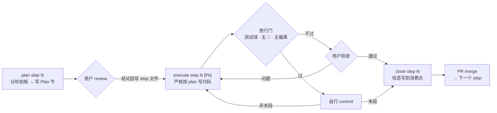

# claude-workflow

Claude Code 项目工作流脚手架：启动前用产品、设计稿、技术选型三步备齐输入，bootstrap 据此搭好架子；之后 **Plan → Execute → Close** 三阶段循环，配 hotfix 与 roadmap 两条快速通道。

源自一个 10 周 / 26 step / 137 commit 的生产项目（Electron + FastAPI 桌面应用，OCR / 本地 LLM / 模型训练三类重集成）的完整实践，并按实践教训做了系统性修订：plan 不写实现代码、文档只写当前状态、信息写到消费点、阶段纪律由 hooks 确定性强制。目标场景：中大型项目起步时搭好架子，把项目拆成线性的 step，step 之间把握大方向不跑偏。

## 核心理念

- **一份给人看，其余给 Claude**：用户只需要打开 `OVERVIEW.md`，它永远短、永远是当前状态；其他文档是 Claude 的记忆，用户不用看
- **Claude 先看全局，再逐层深入**：ARCHITECTURE 随根 CLAUDE.md 在每个 session 启动时自动加载，其中的系统地图一眼看全所有功能在哪、负责什么、依赖谁；进入某个功能的代码时，该功能的域笔记再自动加载
- **知识先放进代码**：代码只有 Claude 读，所以类型、命名、测试名和少量注释承担大部分说明，放不进代码的才写文档
- **文档只写当前状态**：决定被推翻就改写，不留删除线；过程与理由在 step 实录和 commit 正文，历史交给 git
- **信息写到消费点**：给后续 step 的提示写进那个 step 的路线图条目，功能知识写进功能目录，后续 session 不翻历史
- **读取成本不随项目增长**：启动时只带固定上限的全局文档，plan 只读本 step 的路线图条目和相关代码，历史 step 文件没有人读
- **Plan 描述行为与契约，不写实现代码**；「范围外」和「范围内」同等重要，防越界是这套流程的核心价值
- **Execute 的权威输入是 step 文件，不是对话**；每个 step 从干净 context 开始，大 step 阶段间开新会话
- **验收先写成测试，用户只看审美**：plan 给每条验收标准标明验证层级，功能性行为默认自动化测试；execute 过放行门（测试绿、无需用户验证、无偏离）就自行提交并提示下一段
- **阶段纪律由 hooks 确定性强制**，不止靠模型自律
- **汇报用产品语言、固定顺序**：进展与总结只讲用户能看到什么，已定的结论与现状在上，要用户看和决定的在下，👉 下一步收尾；技术细节进 commit 正文与给 Claude 的文档
- **PR 写给人核对**：正文和阶段汇报同一套分段：一句话结论、用户能看到什么不同、和计划不一样的地方（有才写）、✅ 验收、⚠️ 合并风险与遗留、👀 建议重点看；commit 清单 GitHub 已按阶段列出，不重复；技术记录留在 step 文件，PR 只给路径。close、hotfix 与路线图改动建的 PR 都用这个格式

## 快速开始

### 新项目

1. GitHub 上点 **Use this template**（或 clone 后删 `.git` 重新 `git init`）
2. 依次跑启动前的三步，每步 Claude 分轮问你、你确认后提交，详见下面「项目启动」：
   - `/product`：产品说明 `docs/brief/PRODUCT.md`。已有需求文档的作为参数给它
   - `/design-draft`（有界面时）：HTML 设计稿 `docs/design-reference/`，你看两次：关键页定方向，再看其余页面
   - `/tech-stack`：技术方案 `docs/brief/TECH.md`
3. `/bootstrap`：读这三份，不再提问，实例化 OVERVIEW 与 ARCHITECTURE、按技术栈生成代码规范 rules 与 CI、产出 Step 0 plan。不走前三步也可以，给一份简介，缺的由 bootstrap 补问
4. Review milestone 划分、Milestone 1 的 step 与 Step 0 plan，然后 `/execute-step 0` 做出能跑的空项目
5. 之后每个 step 循环：

```text
/plan-step N         → 有需要拍板的先分轮问清 → review plan（结论回写 step 文件）
/execute-step N      → 过放行门自行提交，否则等验收（分段 plan：/execute-step N P1、P2…，每段新 session）
/close-step N        → 信息写到消费点、路线图校验、实录 → merge PR

/hotfix <描述>       （小改动：typo / 一行修复 / 依赖 bump，不走三阶段）
/roadmap <变更描述>  （新需求 / 砍功能 / 拆 milestone / 合并拆分 step / 调顺序 / 中途插入 step，编号如 10a）
```

斜杠形式是确定性调用，自然语言形式（`plan step 3`）同样有效，两种都可以在后面追加补充说明。

**版本要求**：Claude Code 2.1.198 及以上（skill frontmatter 的 `when_to_use` / `arguments`、path-scoped rules、skill 占位符）。任务清单工具在 2.1.233 起的新模型上默认关闭，`.claude/settings.json` 已通过 `env.CLAUDE_CODE_ENABLE_TODO_TOOLS=1` 重新打开。

### 已有项目

把 `.claude/`、`docs/planning/`、`CLAUDE.md` 复制进项目，跑 `/bootstrap`（会读取现状后实例化文档）。技术栈以现有代码为准，不用跑 `/tech-stack`；`/product` 与 `/design-draft` 按需先跑。已有 `CLAUDE.md` 或 `.claude/settings.json` 时**合并而非覆盖**：把本脚手架的 PreToolUse / PostToolUse / SessionStart 条目并入既有 hooks 数组，`env` 同理。`.gitignore` 加上 `.claude/workflow-phase*` 与 `.claude/verify/`。如果设置了 `claudeMdExcludes`，不要排除功能目录下的 CLAUDE.md，否则域笔记不会自动加载。

### 从旧版升级

用新版覆盖 `.claude/hooks/`、`.claude/skills/`、`.claude/rules/planning-docs.md` 与 `CLAUDE.md` 的工作流章节，包括末尾导入 ARCHITECTURE 的一节（保留项目自己的 rules 与 `settings.local.json`；旧版的「关于本项目」按第 12 条处理），然后开一个新会话，让 Claude 按下面的清单搬家，单独一个 PR：

1. `STEPS/STEP_NN_{discuss,plan,close}.md` 按 step 合并成 `STEPS/NN-<slug>.md`，依次放决议、Plan、实录三节，内容原样搬，不改写
2. `PROGRESS.md` 的 step 索引变成 OVERVIEW「已完成」表；hotfix log 删除，git log 里有
3. 每个 `domains/<domain>.md`：删掉契约索引和表索引；决议与行为参考改写成当前状态，去掉删除线和被推翻的原文，放进对应功能目录的 `CLAUDE.md`；按层分目录的项目改写成 `.claude/rules/<feature>.md`，并在 ARCHITECTURE「目录结构」注明；在 ARCHITECTURE「系统地图」为该功能加一行，写目录、技术职责、依赖；在 OVERVIEW「已有功能」为它写两三句产品语言，不写目录
4. OVERVIEW：核心概念移到 ARCHITECTURE；路线图变更日志删除；决议台账里未决的进「待决」，已决的写进 ARCHITECTURE 架构规则或域笔记，被推翻的删除；实录里仍未处理的遗留写进目标 step 条目的「前置提示」
5. ARCHITECTURE 的 ADR 改为「架构规则」：删掉删除线条目，被推翻的只留新结论；目录结构只留顶层与分层惯例；其余写法按第 12 条
6. 项目已有的各层代码规范 `.claude/rules/<layer>.md` 补上或同步「注释与测试」一节，内容照 bootstrap skill 第四步
7. 删除 `PROGRESS.md`、`domains/`、`STEPS/README.md`
8. `.gitignore` 加 `.claude/verify/`。有 UI 但还没有 e2e 框架的项目，下一个 UI step 的 plan 把「e2e 框架就位」纳入范围内；在那之前 UI 的功能性验收用 `[实测]`
9. OVERVIEW「路线图」改为 milestone 与 step 两层：开头说明与格式注释换成新版模板的；现有 step 条目按产品目标归入 milestone（数字编号，带状态行），还说不清的后续范围写进所属 milestone 的「待拆」；「已完成」表不动
10. `CLAUDE.md` 删掉「语言」一节（已移到用户级 `~/.claude/CLAUDE.md`），「沟通风格」换成新版的一节
11. 删除 `.claude/skills/discuss-step/`：discuss 已并入 plan（有需要拍板的事由 plan 先分轮问清），用新版覆盖不会删掉这个旧目录。残留的 `discuss` 阶段标记不再生效，按需 `rm .claude/workflow-phase`
12. ARCHITECTURE 精简，按下面「ARCHITECTURE 精简」的步骤做
13. 域笔记精简，按下面「域笔记精简」的步骤做，在第 12 条之后
14. 确认 `.claude/hooks/package.json` 存在，内容为 `{ "type": "commonjs" }`，逐个复制 hook 文件覆盖的会漏掉它。项目根 `package.json` 设了 `"type": "module"` 时，缺了它 hook 一启动就因 `require is not defined` 退出，Claude Code 把这种退出当作放行且不提示，阶段拦截等于没有。补上后在项目根跑两个 hook 自测
15. OVERVIEW 开头定位句下加一行 `不做：…`，从原需求文档与已有决定里取产品明确不做的事，每条带半句原因，没有写「暂无」；`/roadmap` 加需求时会对照它。`/product`、`/design-draft`、`/tech-stack` 只用于项目启动前，已有项目不用补跑；设计稿不是 `/design-draft` 格式的，execute 不会去维护它的组件库

第 3 到 5 条是改写，让 Claude 在 commit 正文列出删除与合并清单，审这份清单即可。第 12、13 条由独立的 subagent 核对，不需要你审。

#### ARCHITECTURE 精简

ARCHITECTURE 每个 session 都会加载。目标是去掉 Claude 不是每次都要用的内容，留下的写得短而准，挪走的知识一条不丢。不以字数为目标：已经低于 1 万字符、仍有冗余的，继续删。格式以 `.claude/rules/planning-docs.md`「ARCHITECTURE」一节为准。

1. `wc -m` 记下改前字符数，另存一份改前的 ARCHITECTURE 到仓库外，给第 5 步用。根 `CLAUDE.md` 旧版的「关于本项目」也一并处理：定位与 ARCHITECTURE「概述」重复的删掉，其余按下表归类，然后删掉这一节
2. 每一节、每一条归入下面一类：

   | 类别 | 判据 | 处理 |
   |---|---|---|
   | 留下 | 每个 session 都要用，又不能从代码和配置一眼看到 | 按 planning-docs 的格式改写 |
   | 挪走 | 只在改某一层或某几个功能的代码时才用 | 技术栈 → 各层代码规范；只约束几个功能的规则 → 正文合并成一份 `.claude/rules/<规则名>.md`，`paths` 覆盖索引里列出的每个功能，ARCHITECTURE 留索引行，各功能怎么落实可留在各自域笔记；各功能域笔记里与它重复的段落这里不删，留到第 13 条由那里的核对把关；只约束一个功能的 → 该功能的域笔记，不留索引；规则里的实现细节 → 每个功能都要用的进层规范，只和一个功能有关的进该功能域笔记，只和一处代码有关的进代码注释；指向不会自动加载的文件（如设计稿目录）的指路 → 最相关的层规范 |
   | 删除 | 代码、配置、目录一看就知道的（目录树、字段名、枚举值、域笔记 `paths` 里已有的文件清单）；Step 编号；指向 rule 文件或域笔记的指路（读到相关代码时会自动加载；「改这里要连带看另一个功能」不算指路，按局部规则处理）；Claude 默认就会做的指令（如避免过度设计）；与别处重复的 | 直接删 |

3. 复核「挪走」：约束每个 step 都会写的代码的规则（如状态由谁写入、断点续跑、对外分数口径）留在全局。挪进只覆盖几个文件的 rule 文件后，新写的代码读不到它
4. 挪走的内容在同一个提交里写进目标文件。目标文件已有的逐句对照，不重复写；两处说法不一致时以代码为准
5. 独立核对：派一个不带本会话上下文的 subagent，给它改前的 ARCHITECTURE 和本次全部改动，逐条确认改前的每条约束都能在改后的 ARCHITECTURE、rule 文件或域笔记里找到；归入「删除」的，逐条对照第 2 步的删除判据，不符合的补回。补回后再核对一遍
6. commit 正文写：改前、改后字符数；「挪走」清单，每条写内容与去处；「删除」清单，每条一行原因；核对结论

#### 域笔记精简

域笔记在读到该功能任一文件时加载。目标同上：去掉碰这个功能时不需要的内容，挪走的一条不丢。写法以 `.claude/rules/planning-docs.md`「域笔记」一节为准。逐个功能做，每个功能一个提交。

1. `wc -m` 记下改前字符数，另存一份改前的笔记到仓库外
2. 每条归入一类：

   | 类别 | 判据 | 处理 |
   |---|---|---|
   | 留下 | 跨文件的行为、有取舍的决定与否决的方案、实测数据、踩坑、外部依赖改造点、已知缺陷 | 按 planning-docs 的写法改写；实测数字保留测量条件，用户拍板的决定写明 |
   | 挪走 | 只和一处代码有关的「为什么」 | 写成那段代码的注释；注释里已有同样内容的直接删 |
   | 挪走 | 约束几个功能的规则 | 正文合并成一份 `.claude/rules/<规则名>.md`，ARCHITECTURE 加索引行 |
   | 挪走 | 只在部分文件用到的（前端特有、外部包改造点） | 加载范围更窄的笔记或 rule 文件 |
   | 挪走 | 打算做的事、还没验收的行为 | 打算做的事进目标 step 或 milestone 的「前置提示」，没有目标的进 OVERVIEW「待决」；没验收的进「待决」，写成「待验收」，用产品语言写明预期结果 |
   | 删除 | 代码能看到的常量、键清单、公式、函数做了什么；Step 编号；指向在同一场景下会自动加载的文件的指路（「改这里要连带看另一个功能」不算指路，留下或写成局部规则）；与 ARCHITECTURE、层规范或局部规则文件重复的 | 直接删 |

3. 挪走的内容在同一个提交里写进目标文件。新建 rule 文件的 `paths` 要核对到真正读写这些数据的文件，不按文件名猜
4. 独立核对：派一个不带本会话上下文的 subagent，给它改前的笔记与本次全部改动，逐条确认：留下的意思没被改弱；挪走的在去处找得到；删掉的符合判据，说「代码注释里有」的要打开代码核实，说「与某文件重复」的要打开该文件核对，本功能特有的细节没被一起删；新 rule 文件的 `paths` 覆盖所列功能。不符合的补回后再核对一遍。试改 autograder 的标注笔记时，第一遍自己改丢了 5 条、改弱 4 条，都是这一步查出来的
5. commit 正文写法同上

## 项目启动

| 阶段 | 触发语 | 产出 |
|---|---|---|
| 产品 | `/product` | `docs/brief/PRODUCT.md`：定位、用户与场景、核心名词、功能（用户能做到什么、第一版与之后）、不做什么、约束、页面与流程、待定 |
| 设计稿 | `/design-draft` | `docs/design-reference/`：`tokens.css`（全部样式数值）、`components.css` 与 `components.html`（公用组件）、`pages/` 一页一文件、`README.md`（设计原则、页面对照表、组件、未覆盖） |
| 技术选型 | `/tech-stack` | `docs/brief/TECH.md`：形态与平台、各层技术与版本、测试工具、整体结构决定、样式系统、部署、开发方式、待定 |
| Bootstrap | `/bootstrap` | OVERVIEW、ARCHITECTURE、各层代码规范、CI、Step 0 plan |

- **产品说明按 bootstrap 的消费点写**：功能写「用户能做到什么」，直接成为 milestone 与 step 的目标；核心名词进 ARCHITECTURE「核心概念」；「不做什么」进 OVERVIEW 开头，`/roadmap` 加需求时对照。产品说明不谈技术。
- **设计稿双击即开**：纯 HTML + CSS，不绑前端框架，不需要构建或启动服务。所有数值集中在 `tokens.css`，组件样式只写一份，页面都引用它们，改一处全部跟着变。先在一两个关键页（最常用、最复杂的）上定配色、字体与布局，用户确认后再铺开第一版的其余页面；之后版本的页面列进「未覆盖」。审美方向可借助官方 frontend-design skill。
- **技术选型排在设计稿之后**：设计稿能看出界面需要哪些能力（大表格、图表、拖拽），选库时照着挑；使用设备与离线要求已在产品说明里。Claude 先查资料定出完整方案，只拿影响用户的选择（费用、部署、平台、熟悉的语言）来问。
- **生命周期不同**：`docs/brief/` 两份只给 bootstrap 用一次，之后需求变化走路线图，技术约定以代码规范为准；`docs/design-reference/` 在每个做界面的 step 都会被读，并由 execute 随代码维护。
- 启动前的三步与 bootstrap 一样不设阶段标记：还没有代码要保护，各 skill 只写自己的产出文件。也因此 resume / compact 后没有 SessionStart 提示，接着做时自己重新调用当前的 skill，它的「续接」说明会从中断处接上。
- **开工后设计稿由 execute 随代码维护**：新增组件库里没有的公用组件，或改了已有组件的样子、样式数值，在同一个提交里更新 `components.css`、`components.html`、README 组件表与 `tokens.css`，两边不一致时以代码为准。没有设计稿的页面，plan 写明按已有组件与样式做，视觉交给 step 验收时用户看。

## 三阶段与两条通道

| 阶段 | 触发语 | 产出 | 纪律（hooks 强制） |
|---|---|---|---|
| Plan | `/plan-step N` | 有需要拍板的先分轮问清，写进 step 文件「决议」节；step 文件「Plan」节；路线图对齐闸门 | 只能写文档 |
| Execute | `/execute-step N [Pk]` | 代码 + 测试 + 域笔记 + 设计稿组件库同步；commit 正文记偏离 / 临场决策 / 遗留 / 验收；过放行门自行提交 | **禁止**写 planning 文档 |
| Close | `/close-step N` | 信息写到消费点、路线图校验、本 step 出过的错转成检查或规则、step 文件「实录」节 + PR | 只能写文档 |
| hotfix | `/hotfix <描述>` | 小改动直接提交，文档有句子失效就顺手改 | 无标记 |
| roadmap | `/roadmap <描述>` | 路线图与待决 | 只能写文档 |

「文档」= `docs/planning/` + `.claude/rules/`。功能目录下的 `CLAUDE.md` 域笔记各阶段都可写。



### 验收层级与放行门

plan 给每条验收标准标明验证层级，execute 按层级逐条自检：

| 层级 | 含义 | 谁做 |
|---|---|---|
| `[自动]` | 写成测试，plan 写出测试名；功能性行为（点了之后发生什么、表单校验、路由、错误呈现）默认在这一层 | execute 写，CI 跑 |
| `[实测]` | Claude 用 e2e 框架的一次性脚本 / 浏览器工具 / curl / CLI 验证一次，产物不进 repo；只用于测试框架覆盖不到的集成点与实测数据，值得重复跑的升为 `[自动]` | Claude |
| `[手动]` | 只允许审美（视觉、动效、手感）与本机无法复现的真实外部环境；审美项 Claude 先截图到 `.claude/verify/`，用户看图 | 用户 |

段退出验收只允许前两层，审美项统一放 step 级验收。自检后三条全满足就过放行门：测试与类型检查 / build 绿、checklist 没有 👀（待用户确认）与 ❌、没有偏离或只有用户中途已裁决的小偏离。过门的段 execute 自行 commit，输出「✅ 已提交」与「👉 下一步」两行；末段同样自行 commit，完整汇报夹在这两行之间。不过门才等用户验收后 commit，commit 正文的「验收」段按用户结论改写，close 以它为准。「测试完全覆盖」的定义是每条验收标准都对应到一个通过的测试或一次实测，不用覆盖率。测试按「注释与测试」写，验收测试须在实现前因结果不符而失败过，「测试绿」才可信。放行门前，一个不带上下文的 subagent 对照 step 文件审一遍改动：漏做、多做、做错、测试写法。

## 文档体系

### 五种文档

| 文件 | 内容 | 谁读 |
|---|---|---|
| `docs/planning/OVERVIEW.md` | 已有功能、路线图、待决、已完成 | 用户；plan 读本 step 的条目 |
| `docs/planning/ARCHITECTURE.md` | 概念、约束、目录惯例、系统地图、架构规则 | 每个 session 启动时自动加载 |
| `docs/planning/STEPS/NN-slug.md` | 每 step 一个文件：决议、Plan、实录 | 当前 step 使用，close 后是存档 |
| 功能目录下的 `CLAUDE.md` | 域笔记：该功能放不进代码的知识 | 读到该功能的代码时自动加载 |
| `.claude/rules/*.md` | 按层的代码规范；只约束几个功能的架构规则 | 读到对应文件时自动加载 |

启动前另有两份输入，不在这五种之内：`docs/brief/`（产品说明与技术方案，bootstrap 用一次后不再更新）与 `docs/design-reference/`（设计稿，做界面的 plan / execute 按页面对照表读，execute 新增公用组件时更新组件库）。

`OVERVIEW.md` 是用户唯一的入口。四节中「已有功能」「待决」体量恒定。「路线图」分 milestone 与 step 两层：milestone 全程保留，完成的只留目标与完成记录；step 走到时再拆，完成后移到「已完成」表。中途因需求变化要插进来的 step 用字母后缀编号（Step 10 与 11 之间依次为 10a、10b），后面的 step 不用改号。「已完成」表每个 step 长一行，那一行就是用户的时间线。

Claude 的读取路径分三层，每层都小、都是当前状态、都指向下一层：

1. **全局**：ARCHITECTURE 由根 CLAUDE.md 导入，启动即加载，不用任何工具调用。系统地图每个功能一行，写目录、一句话职责、依赖；架构规则只放全局的，只约束几个功能的放进 rule 文件，这里留一行索引。只写每个 session 都要用、又不能从代码和配置一眼看到的；1 万字符（约 7000–8000 token）是报警线。
2. **功能**：读到某个功能目录里的文件时，它的域笔记自动加载。只写碰这个功能就要用的：跨文件的行为、有取舍的决定、实测、踩坑、已知缺陷；只和一处代码有关的「为什么」写在代码注释里。8000 字符是报警线。
3. **代码**：类型、命名、测试名和少量注释。

启动时多带一份只装每个 session 都要用的内容的 ARCHITECTURE，并不会让 session 变慢。慢的来源是 Claude 为了摸清情况连续打开文件、搜索，每一轮都要等；这份全局文档正好省掉这些摸索。

域笔记用的是 Claude Code 的原生机制：子目录里的 `CLAUDE.md` 不在启动时加载。Claude 读一个文件时，从根目录到该文件沿路每一级目录的 `CLAUDE.md` 都会注入，同级的其他目录不会；compact 后也会随读取重新加载（2.1.283 实测）。所以功能知识零启动成本，碰到哪个功能就只加载哪个功能的，也不需要任何索引。

### 域怎么划分

域的边界由目录结构决定，bootstrap 定一次，Claude 不在每个 step 重新判断：

- **功能目录就是域**。新项目按功能分目录、功能内部再分层，写进 ARCHITECTURE「目录结构」；新功能由 plan 在「范围内」指定新目录，你 review 时就能看到边界，close 再把它加进系统地图。
- **放置规则只有一条**：知识写进包含它涉及的全部代码的最低一级目录。那是某个功能目录，就写进它的 `CLAUDE.md`；涉及多个功能，全局的写进 ARCHITECTURE，能列出只约束哪几个功能的写进 rule 文件、ARCHITECTURE 留一行索引。
- **只放一层**：沿路每一级都会加载，层数越多读得越多。笔记只放在功能目录，压缩后仍然太长才拆到子目录。
- **按层分目录的项目**（已有项目或框架强制，如 Rails）没有功能目录可放笔记，改用 path-scoped rule：每个功能一份 `.claude/rules/<feature>.md`，`paths` 列出该功能在各层的文件。hook 不允许 execute 写 rules，所以这类项目由 execute 把知识写进 commit 正文，close 写入文件。`paths` 没列出的文件读写时不加载，所以给已有功能新增的文件由 plan 定稿时加进 `paths`，close 按实际文件核对。
- **新代码与局部规则**：只约束几个功能的规则也只在读写它 `paths` 里的文件时加载，新功能、已有功能第一次做某类事都不在其中。plan 按 ARCHITECTURE 的索引判断新代码受哪几条约束，写进 Plan，并把新代码所在的文件加进 `paths`、所属功能加进索引；execute 开工前读这几条的正文，close 按实际文件核对。

```text
按功能分：域笔记放功能目录           按层分：域笔记用 path-scoped rule
backend/app/ocr/                     backend/app/models/ocr.py
  CLAUDE.md                          backend/app/services/ocr.py
  router.py                          backend/app/routers/ocr.py
  service.py                         .claude/rules/ocr.md
  models.py                            paths: backend/app/*/ocr*.py
```

### 信息去处

完整的表在 `.claude/rules/planning-docs.md`，要点：

- 用户可见的功能现状写 OVERVIEW「已有功能」，未决问题与还没验收的行为写「待决」
- 给某个后续 step 的提示写进 OVERVIEW 路线图里那个 step 的「前置提示」，尚未拆出的写进所属 milestone
- 已有功能的目录、职责、依赖写 ARCHITECTURE「系统地图」；涉及多个功能的规则，全局的写「架构规则」，只约束几个功能的写进 rule 文件并在 ARCHITECTURE 留索引
- 单个功能内放不进代码的知识写该功能的域笔记：跨文件的行为、实测数据、否决过的方案、外部依赖改造点、已知缺陷
- 过程（偏离、临场决策、遗留、验收、推翻了什么、路线图为什么改）只写 step 实录与 commit 正文：close 读 execute 的 commit 正文，之后是存档
- PR 正文只给核对合并的人看，后续阶段不读，任何知识都不能只写在这里
- 决定须同时满足三条才写：撤回代价大、不知道背景的人会觉得奇怪或想改掉、当时有真实的备选
- 代码能回答的不写

### 代码里写什么

代码只有 Claude 读，判断标准只剩一条：这段文字能不能让下一个 session 少走几轮、少犯错。知识离「能被机器检查」越近越不会过期，所以按下表从上往下放：

| 层 | 放什么 | 会不会过期 |
|---|---|---|
| 命名、类型、schema、enum | 数据形状、取值范围、约束 | 不会，类型检查和运行时校验会发现 |
| 测试，测试名描述行为 | 功能性行为与 edge case | 不会，过期测试就失败 |
| 代码旁的注释 | 故意为之、看起来像 bug 的写法的原因；会被其他功能调用的函数的契约 | 很少，和代码在同一个 diff 里改 |
| 域笔记 | 跨文件的行为、实测数据、否决过的方案、已知缺陷 | 可能，靠 close 核对 |
| ARCHITECTURE | 系统地图、全局规则、局部规则的索引 | 可能，靠 close 核对 |

复述代码的注释、教程式说明、长篇 docstring、注释掉的旧代码都不写。bootstrap 会把这套写法作为「注释与测试」一节写进每一份代码规范 rule。

### 每个阶段读什么

| 阶段 | 读 |
|---|---|
| 任何会话 | 根 `CLAUDE.md` 与它导入的 ARCHITECTURE（启动时自动）；读到的代码所属功能的域笔记与 rules（自动） |
| plan | OVERVIEW 中本 step 条目、所属 milestone 的前置提示与相关待决、相关代码、新代码受约束的局部规则正文 |
| execute | 本 step 文件、相关代码、Plan 点名的局部规则正文 |
| close | Plan 节的「目标」「文档影响」「执行分段」、commit 正文、`git diff --stat`，之后只为写入定点读 |
| roadmap | OVERVIEW、受影响 step 的 Plan 目标 |
| hotfix | 不额外预读 |

没有阶段读历史 step 文件，这是读取成本不随 step 数增长的关键：close 负责把后续需要的东西推到消费点。

### 压缩

close 发现 ARCHITECTURE 超过 1 万字符、或碰过的域笔记与局部规则文件超过 8000 字符时，会问你是否顺带压缩。压缩只允许合并重复、删除被取代的条目、把历史叙述改写成当前状态、把只约束部分功能的规则挪到用到时才加载的文件；仍在生效的约束不删，拿不准就保留。ARCHITECTURE 有固定顺序：先按写法改回，再把局部规则挪出去，再合并同主题的规则，最后删新代码违反也会被自动检查拦下的（只测现有功能的测试不算）；都做完还超，由你决定是否提高上限。压缩完由一个不带上下文的 subagent 对照改前版本逐条核对，再在 commit 正文列出删除、合并与挪走的清单；删掉的内容 git 里都在。

## Session 策略

小 step 可 plan → execute → close 同会话连跑（review 结论仍须回写 step 文件，close 仍以 commit 正文与 git diff 为准）；大 step 阶段间开新会话或 `/clear`。execute 单 session 装不下的 step 优先拆成几个 step；拆开单独没有意义的，由 plan 阶段拆成 P1/P2… 执行段（按功能切，先打通最细的完整路径），每段新开 session 执行（`/execute-step N P1`…），段末必须是可验证的完整状态，段间交接只靠 git commit 与 step 文件。段退出验收只有自动化与实测项，过放行门后 Claude 自行提交并提示下一段，用户只在末段看审美项。

plan-step 的分段阈值按 200K 窗口校准，1M 窗口的模型可以放宽，但仍以质量优先；关闭了 auto compact 时分段要更保守。resume 或 compact 之后 SessionStart hook 会播报当前阶段，按提示重新调用对应 skill 即可从中断处继续；新会话接着做未完成的阶段（如隔天继续 review plan）也一样，先重新调用该阶段的 skill。

## 目录结构

```text
.
├── CLAUDE.md                        # 项目指令：沟通风格、文档地图、触发语 → skill、阶段纪律、git 约定；末尾导入 ARCHITECTURE
├── .claude/
│   ├── settings.json                # hooks 配置（PreToolUse / PostToolUse / SessionStart）+ env
│   ├── rules/
│   │   └── planning-docs.md         # 文档写作规则与信息去处（读写文档时自动加载）
│   │                                # bootstrap 会在这里生成 backend.md / frontend.md 等代码规范
│   ├── hooks/
│   │   ├── phase-guard.js           # PreToolUse：按阶段拦截越界写入（Write/Edit + Bash/PowerShell 启发式）
│   │   ├── phase-guard.test.js      # 守卫自测（node 运行，53 用例）
│   │   ├── phase-audit.js           # PostToolUse：Bash/PowerShell 之后用 git status 兜底审计
│   │   ├── phase-audit.test.js      # 审计自测（node 运行，19 用例，需要 git）
│   │   ├── clear-phase.js           # SessionStart(startup|clear)：清残留阶段标记
│   │   ├── announce-phase.js        # SessionStart(resume|compact)：播报当前阶段、提示重调 skill
│   │   └── package.json             # 声明 CommonJS：项目根设了 "type": "module" 时 hook 照常加载
│   ├── skills/                      # product / design-draft / tech-stack / bootstrap / plan-step / execute-step / close-step / hotfix / roadmap
│   └── verify/                      # execute 的审美截图与实测产物（gitignored，运行时才出现）
├── docs/brief/                      # /product 与 /tech-stack 产出（运行后才出现）：PRODUCT.md、TECH.md
├── docs/design-reference/           # /design-draft 产出（运行后才出现）：tokens.css、组件、pages/、README 页面对照表
├── docs/planning/
│   ├── OVERVIEW.md                  # 给用户看的总览：已有功能、路线图、待决、已完成
│   ├── ARCHITECTURE.md              # 给 Claude 的全局：概念、约束、目录惯例、系统地图、架构规则（根 CLAUDE.md 导入）
│   └── STEPS/                       # 每 step 一个文件：决议、Plan、实录
└── .github/ci.yml.example           # CI 模板：测试、类型检查 / 构建、e2e（bootstrap 实例化为 workflows/ci.yml）
```

项目跑起来之后，功能目录里会逐步出现 `CLAUDE.md` 域笔记，例如 `backend/app/ocr/CLAUDE.md`。

## 阶段纪律（hooks）

各阶段 skill 把阶段名写入 `.claude/workflow-phase`，三道 hook 据此工作：

1. **`phase-guard.js`（PreToolUse）**：Write / Edit / NotebookEdit 按路径判断；Bash / PowerShell 从命令文本启发式提取写入目标（重定向、heredoc 首行、tee、sed -i、mv / cp / rm / touch / mkdir、git rm / mv、Set-Content / Out-File / Remove-Item 等），越界写入直接拒绝。含变量或命令替换的路径 fail-open，但文本里出现 `docs/planning` 或 `.claude/rules` 的一律按文档处理；`git restore` / `git clean` 不算写入，审计要求回滚时不会被自己拦住。必须拦 Bash 的原因：auto 权限模式下 Claude Code 会引导模型优先用 Bash 改文件，只拦 Write/Edit 等于没拦。
2. **`phase-audit.js`（PostToolUse）**：每次 Bash / PowerShell 之后跑 `git status`，execute 阶段文档范围内不该有未提交改动，其他阶段文档范围外不该有；发现即报告并要求回滚。同一组文件只报一次。
3. **SessionStart**：`clear-phase.js` 在新会话清除残留标记；`announce-phase.js` 在 resume / compact 时播报当前阶段并提示重新调用 skill。

域笔记（功能目录下的 `CLAUDE.md`，根目录与 `.claude/` 下的除外）两道检查都放行。启发式拦不住的写法（`python -c` / `node -e` 里的 fs 调用）由审计兜底。

hook 用 CommonJS 写，`.claude/hooks/package.json` 声明 `"type": "commonjs"`，项目根 `package.json` 设了 `"type": "module"` 也照常加载。hook 报错退出（退出码不是 2）时 Claude Code 照常放行、不提示，拦截失效也看不出来，所以改动 hook 或项目根 `package.json` 的 `type` 后，在项目根跑自测：

```text
node .claude/hooks/phase-guard.test.js
node .claude/hooks/phase-audit.test.js
```

仍遇误拦时手动 `rm .claude/workflow-phase`。不想要 hooks：删除 `.claude/settings.json` 中的 `hooks` 段与 `.claude/hooks/` 目录，纪律退化为 skill 文本约束。

## 与 Claude Code 内建能力的配合

- **`/code-review`**：execute-step 在末段验收后建议 `/code-review high origin/main...HEAD`。不要用 `--fix`：它的修改在会话 checkpoint 之外、`/rewind` 撤不掉，也绕过 execute 的分流规则。触及鉴权 / 数据访问的 step，close-step 建 PR 前提示 `/security-review`。
- **frontend-design skill**：`/design-draft` 定配色、字体与整体方向时会加载（`/plugin install frontend-design@claude-plugins-official`）；没装也能出稿，页面结构与产出格式以 `/design-draft` 为准。
- **subagent**：execute 的大规模机械改造用 `fork` 类型并行分组（继承 step 文件与已读代码）。
- **浏览器工具**：execute 的 `[实测]` 项与审美截图用 Claude in Chrome（截图 `save_to_disk` 后挪进 `.claude/verify/`）或 e2e 框架的一次性脚本。值得重复跑的写成 `[自动]` 进 repo、CI 跑；浏览器 MCP 是否可用取决于环境。
- **不适合的**：阶段 skill 不要加 `context: fork`（它们需要与用户交互）；不要用 skill frontmatter 的 `hooks` 取代标记文件（skill hook 在整个 session 持续生效，同会话连跑 plan → execute 会叠加相反规则）；不要给阶段 skill 设 `disable-model-invocation`（会让自然语言触发失效）。

## 定制

- `CLAUDE.md`：git 约定按团队习惯改。语言与通用沟通风格（按产品负责人视角汇报、用日常说法）写在用户级 `~/.claude/CLAUDE.md`，换电脑要一起带上；项目里的「沟通风格」只写本流程专用的部分：哪些文档保持技术精确、阶段汇报的顺序与标记
- `skills/*/SKILL.md`：各阶段步骤可按项目形态微调（如层推进顺序、验收要求）
- `.claude/rules/planning-docs.md`：压缩阈值、域笔记结构按项目调整
- `.claude/settings.json`：不想恢复任务清单工具就删掉 `env.CLAUDE_CODE_ENABLE_TODO_TOOLS`（skill 会退化为文字清单）；commit / PR 的署名通过 Claude Code 的 `attribution` 设置控制

## License

MIT
